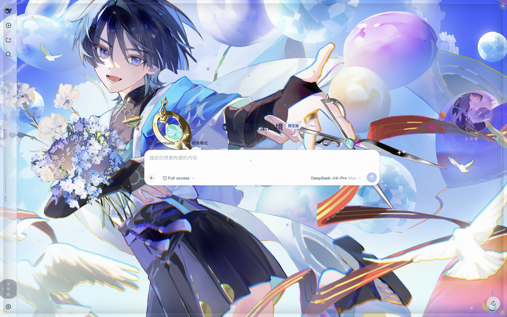
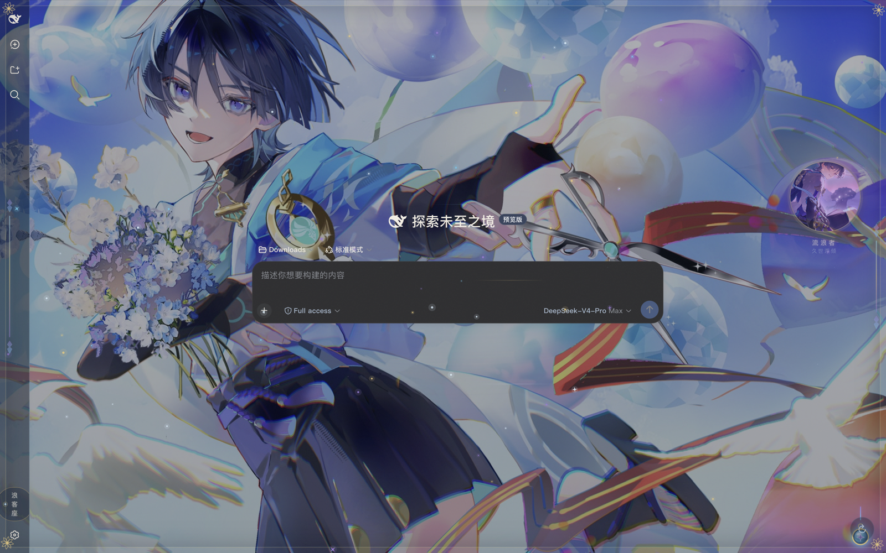

# 原神流浪者主题美化 · dsh-theme-wanderer

DeepSeek Harness 的**常驻主题插件**（bundle 形式安装，重启后依然生效），以《原神》角色「流浪者」为核心的幻想风界面主题：**动态壁纸（视频）+ iOS 27 液态玻璃 + 浅/深色自动适配**。

> 主题名：**原神流浪者主题美化** · Wanderer Theme v3.0.0

## 🖼️ 界面预览





> 🌙 推荐使用**深色外观**：暮色滤镜下壁纸层次与鎏金描边对比度最佳。
> 📺 v3 起壁纸为**动态视频**，静态截图无法呈现流动效果。

## ✨ 效果

- **动态壁纸**：视频壁纸铺满背景（支持 HTTP Range 分块流式加载与循环播放），暂停或 `prefers-reduced-motion` 时自动降级为静态海报
- **iOS 27 液态玻璃**：主列（侧栏/内容/右栏/底栏）应用 `backdrop-filter: blur(30px) saturate(190%)`，配顶部高光内阴影与发丝边；金箔卡片使用 40px 大半径玻璃
- **浅/深色自动适配**：跟随系统 `prefers-color-scheme`，两套玻璃配色、标题/正文/卡片描边分别调校
- **风元素粒子**：Canvas 流动微尘 + 四芒星（神之眼星型）+ 螺旋轨道粒子 + 风痕流线
- **装饰元素**：全屏鎏金卷轴边框、左右紫色绳穗与青绸滚边、绸带分割线、青绸滚动条、风语题签（输入框下方）
- **个人中心 · 浪客座**：侧栏「浪客座」入口 → 角色档案、四重名号画廊（国崩 / 倾奇者 / 散兵 / 流浪者）、命之座六星图（按会话次数点亮）
- **设置页**：动态壁纸/星尘/粒子/边框/滚边/题签 6 个开关 + **自检与诊断面板** + **版权与来源**说明
- **自检机制**：启动素材与视频预热自检、`/wanderer-theme/health` JSON 健康端点、浏览器控制台 `[dsh-theme-wanderer]` 日志

## 📁 结构

```
cordis.patch.yml   bundle 补丁: 插入 wanderer-theme 行(inject: fs, webServer)
lib/index.js       Host 半部: 素材与视频路由(Range 206) + health 端点 + 启动自检
client/client.js   Client 半部: 主题令牌、液态玻璃样式、动态壁纸视频、粒子、个人中心、设置页、自检面板
docs/              界面预览截图
```

## 📦 安装

```bash
# 以 bundle 形式安装(自动写入 profile 的 dependencies、bundles 与补丁行)
dsh plugin --profile web add github:yumonai/dsh-theme-wanderer
```

重启 `dsh web` 并彻底退出重开 Web 界面即可生效。

> ⚠️ 手动安装请勿使用 `file:` 协议：pnpm 会把依赖**拷贝**进 store，之后修改源码不会生效；使用 `link:` 或上面的 bundle 安装。

## 🖼️ 壁纸与素材路径

主题默认读取以下本机路径，可在 profile 的 `cordis.patch.yml` 中覆盖：

```yaml
- id: wanderer-theme
  config:
    videoPath: /path/to/your/video.mp4     # 动态壁纸视频
    assetsDir: /path/to/your/assets        # 角色素材目录(静态海报与个人中心画廊)
```

默认值：
- 视频：`/Users/yuzhengdong/Downloads/16-10(4K).mp4`
- 素材：`/Users/yuzhengdong/Downloads/流浪者素材`

## ⚖️ 版权与来源

- **动态壁纸视频**《16-10(4K)》由主题使用者本人于 **Bilibili 小店向画师购买授权**，版权归原作者所有。
- 本插件**不包含**该视频与任何《原神》角色素材，仅在本机读取本地文件用于个人界面美化，**不随插件分发**——他人安装后需自备素材，否则自动降级为纯色/无图界面。
- 《原神》角色形象与美术素材版权归 **miHoYo / HoYoverse** 所有；本主题为**非官方粉丝作品**，与官方无关。

## 🔧 诊断与排查

三层诊断：**终端日志**（`[dsh-theme-wanderer]` 前缀，启动自检 + 每次请求）→ **`/wanderer-theme/health`**（JSON：素材/视频字节与错误）→ **设置页自检面板**（素材服务、视频、令牌注入、玻璃生效）。

| 症状 | 原因 | 解决 |
| --- | --- | --- |
| 重启后主题/壁纸消失 | 页面缓存：Web App 重连不重载 HTML | 彻底退出 Web App 再打开，或浏览器 Cmd+Shift+R |
| 动态壁纸不播放 | 视频路径不存在/不可读 | 看终端自检 `video FAIL`；改 `config.videoPath` |
| 壁纸是静态图且无动画 | `prefers-reduced-motion` 开启 / 设置里关闭了动态壁纸 | 系统关闭「减弱动态效果」或在设置页重新开启 |
| 玻璃效果不明显 | 显卡/浏览器不支持 `backdrop-filter` | 自检面板「液态玻璃已生效」为 ✗ 时即为不支持 |
| 素材路由返回 SPA 页面或 401 | 直接 curl 探测时缺少认证/rev 参数 | 以终端自检日志与 health 端点为准 |
| 改了源码不生效 | `file:` 依赖被 pnpm 拷贝进 store | 用 `link:` 协议或 bundle 安装 |
| `ERR_MODULE_NOT_FOUND`（全局 dsh 启动） | pnpm 全局隔离布局导致加载器找不到行包 | 用 npm 全局安装 dsh，或把 bundle 装进 profile |

## 📄 许可

代码 MIT。角色与视频素材版权见上方「版权与来源」。
